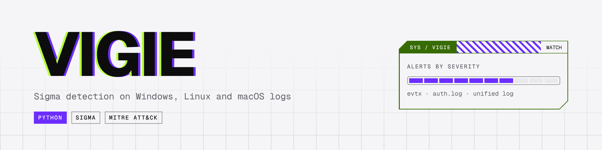
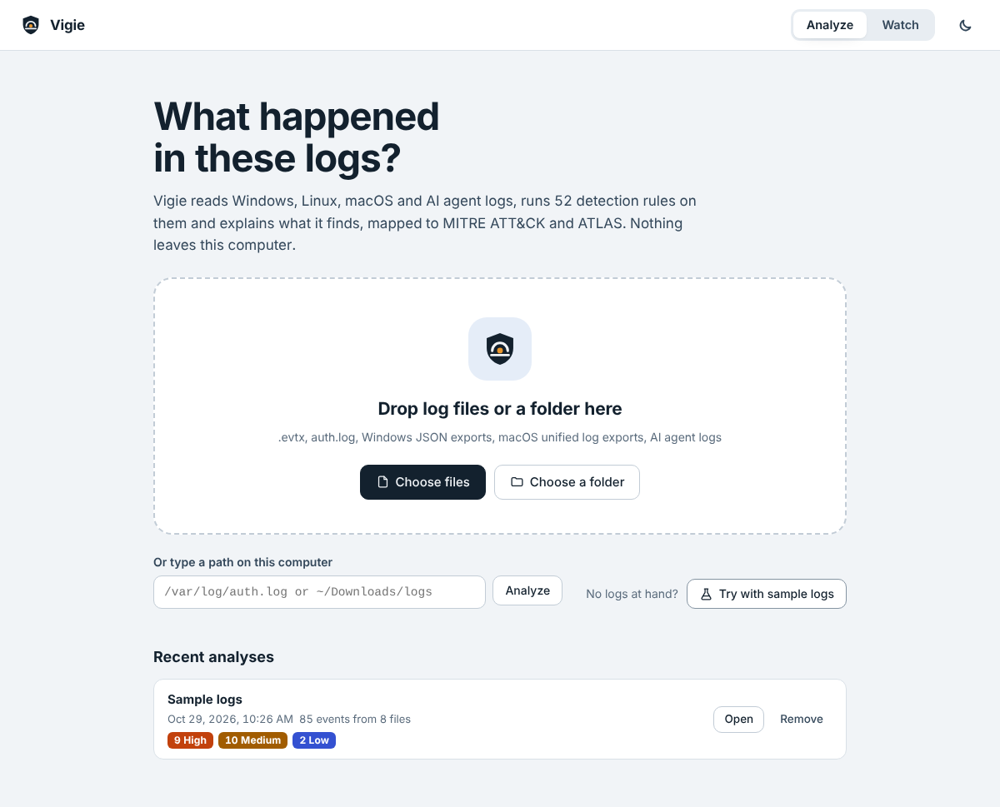
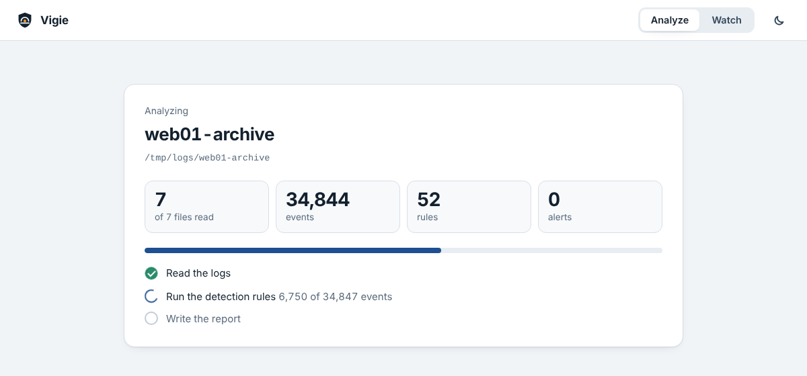
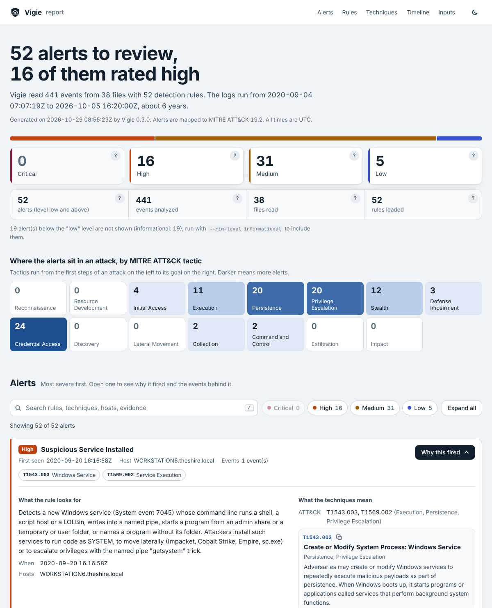

<picture>
  <source media="(prefers-color-scheme: dark)" srcset="docs/banner-dark.png">
  
</picture>

# Vigie

[](https://github.com/Bouliw/vigie/actions/workflows/ci.yml)

Vigie is an open source blue team tool that reads Windows, Linux and macOS
logs, and the activity logs of AI agents and LLM applications, runs Sigma
detection rules on them and writes a report an analyst can read: alerts ranked
by severity, mapped to MITRE ATT&CK (and, for attacks on AI systems, to the OWASP Top 10
lists for LLM and agentic applications), with the
events behind each one and a timeline. It works on
collected logs or live, as the logs are written, from a desktop app or from
the terminal.

## Download the app (no Python needed)

Vigie also comes as an app for Windows and for Macs with Apple silicon, with
everything it needs inside: nothing else to install, and no administrator
right needed.

1. Open the [latest release](../../releases/latest) of this repository
   and download **Vigie-windows.zip** or **Vigie-macos.zip**.
2. **Windows**: right-click the downloaded file, choose **Extract All**, pick
   a folder where Vigie can stay (Documents, for example), open the extracted
   **Vigie** folder and double-click **Vigie.exe**. Extract it first: Vigie.exe
   does not run from inside the zip file. The Desktop icon made at the first
   launch points to that folder, so move it before the first launch, not after.
3. **macOS**: double-click the downloaded file to unzip it, move **Vigie.app**
   to your **Applications** folder, then double-click it.

The apps are not signed with a certificate that Windows or macOS know, so the
first launch needs a confirmation:

- **Windows** may say "Windows protected your PC": click **More info**, then
  **Run anyway**.
- **macOS** says that Apple could not verify "Vigie" is free of malware: click
  **Done**, open **System Settings**, **Privacy & Security**, and click **Open
  Anyway** next to the message about Vigie, then confirm. On macOS 14 and
  earlier, you can instead Control-click (or right-click) Vigie.app, choose
  **Open**, then **Open** again.

From then on, a double-click opens Vigie in your browser. It has no window of
its own: it stops by itself a few minutes after its last page is closed. On
Windows, the first launch also adds a Vigie icon to the Desktop. Reports and
the `app.log` file, which says what went wrong if Vigie does not open, are in
`%LOCALAPPDATA%\Vigie` on Windows and `~/Library/Application Support/Vigie` on
macOS. To remove the app, delete the Vigie folder (and its Desktop icon) or
Vigie.app.

The Mac app runs on Apple silicon (M1 and later). On an Intel Mac, use the
installer below, which needs Python.

## Install without a terminal

You need Python, then the installer of your system sets up everything else:
Vigie in its own environment, an icon to open it, and the app opens at the
end. Nothing is installed for other users, and no administrator right is
needed.

**Windows**

1. Install Python from [python.org/downloads](https://www.python.org/downloads/).
   On the first screen of its installer, tick **Add python.exe to PATH**.
2. On this project's GitHub page, click **Code**, then **Download ZIP**. Right-click
   the downloaded file, choose **Extract All**, then open the extracted folder.
3. Double-click **Install Vigie (Windows)**.

Windows may stop it the first time with "Windows protected your PC": click
**More info**, then **Run anyway**. It can also ask "Do you want to run this
file?": click **Run**. The installer is a plain text script you can read first
in Notepad (`Install Vigie (Windows).bat` and `installer\install.ps1`).

**macOS**

1. Install Python from [python.org/downloads](https://www.python.org/downloads/)
   (the macOS installer).
2. On this project's GitHub page, click **Code**, then **Download ZIP**, and
   double-click the downloaded file to unzip it.
3. Double-click **Install Vigie (macOS).command**.

macOS stops a script downloaded from the internet the first time ("cannot be
opened because Apple cannot check it"). Control-click (or right-click) the
file, choose **Open**, then **Open** again. If macOS does not offer that
button, close the message, open **System Settings**, **Privacy & Security**,
and click **Open Anyway** next to the message about the installer, then
confirm. The installer opens a Terminal window to show its progress; that is
expected.

**Linux**

1. Install Python 3.10 or later, with its `venv` module (on Debian and Ubuntu:
   `sudo apt install python3 python3-venv`).
2. Download the ZIP from this project's GitHub page (**Code**, **Download ZIP**)
   and extract it.
3. Double-click **install-linux.sh** and choose **Run in Terminal** (or run
   `./install-linux.sh`). If your file manager opens it as text, allow it to
   run scripts, or right-click it, **Properties**, **Permissions**, **Allow
   executing file as program**.

Afterwards, open Vigie with its icon on the Desktop (Vigie.app on macOS; on
Linux, also in the applications menu). Running the installer again upgrades
Vigie in place; **Uninstall Vigie** (`uninstall-linux.sh` on Linux) removes
its environment and the icon, and keeps your reports. Vigie lives in
`%LOCALAPPDATA%\Vigie` on Windows, `~/Library/Application Support/Vigie` on
macOS and `~/.local/share/vigie` on Linux, with an `install.log` that says
what the installer did.

## Two ways to use it

**The app.** The Vigie icon (or `vigie ui` in a terminal) opens Vigie in
your browser, served from your own computer only: drop log files or a folder,
or try the sample logs, follow the analysis, then read the report, open it in
the browser or show its file. The Watch tab follows logs as they are written,
with alerts as they come. Nothing leaves your computer.





**The terminal.** `vigie demo` shows a report of sample logs in seconds,
`vigie analyze` analyzes a folder of logs, `vigie watch` follows logs live and
prints alerts as they happen (see [Usage](#usage)). Installed with pip, Vigie
also adds the app's icon to your Desktop the first time it runs in a
terminal, and says so; `vigie shortcut --remove` removes it for good, and
`VIGIE_NO_SHORTCUT=1` skips it.

Vigie is small enough to read in an afternoon, and built with the care a
detection tool needs (every rule tested with positive and negative cases,
known limits written down).

## What it does

- **Reads** Windows event logs (`.evtx`: Security, System, Sysmon, PowerShell),
  Windows events exported as JSON lines (the format of the OTRF
  Security-Datasets, `.json` or `.zip`) and Linux `auth.log` / `secure` files
  (classic syslog or RFC 3339, `.gz` rotated files, OpenSSH 9.8+ `sshd-session`).
  EVTX and auth.log files are recognized by their content, whatever their name;
  JSON exports need a `.json`, `.jsonl` or `.zip` extension.
- **Reads the macOS unified log**: live through `log stream`, without
  administrator rights, or exported with `log show --style ndjson` (`.ndjson`,
  `.json` or `.jsonl`).
- **Reads AI agent and LLM application logs** in JSON Lines: a simple,
  vendor-neutral schema (prompts, responses, tool calls and results, retrieved
  documents), OpenAI Chat Completions calls as API gateways log them, and
  Model Context Protocol (MCP) traffic. See
  [AI agents and LLM applications](#ai-agents-and-llm-applications).
- **Watches** logs as they are written: auth.log files and agent logs followed
  like `tail -F`, through rotation, and the unified log of the Mac it runs on. Alerts are
  printed as they happen, the most severe raise a macOS notification, and an
  HTML report reloads itself in the browser.
- **Detects** with 53 Sigma rules evaluated by its own engine, including Sigma
  v2 correlation rules: brute force, password spraying, "successful login right
  after a brute force", launch agents and daemons (and those posing as Apple's),
  Gatekeeper blocks and XProtect behavioral detections, and, for AI agents,
  direct and indirect prompt injection, poisoned MCP tool descriptions,
  jailbreaks, system prompt extraction and leaks, secrets and personal data in
  model output, dangerous tool calls (including right after an injection),
  exfiltration through tools or images, and abnormal request volumes.
- **Maps** every alert to MITRE ATT&CK 19.2, or for the AI rules to the OWASP
  Top 10 for LLM Applications 2025 and for Agentic Applications 2026, offline.
- **Reports** in self-contained HTML, Markdown and JSON: summary, technique
  and OWASP coverage, alerts with their rule, author and evidence,
  timeline, and what was read, skipped or rejected.

## Quick start

```bash
pip install .     # from a clone of this repository, see Installation
vigie demo
```

`vigie demo` analyzes the sample logs shipped with Vigie (synthetic AI agent
logs and a Linux auth.log), writes the HTML report to a temporary folder and
opens it in your browser. On your own logs: `vigie analyze ./logs --open`.

## Report preview



The HTML report is one file that works offline. It opens on what was found
and how severe it is, then a heatmap of the tactics the
alerts map to. Each alert opens on "Why this fired": what the rule looks for,
what each technique means, the false positives to rule out, the rule's
metadata and references, and the events behind it. A toolbar filters by
severity, text (press `/`), technique, tactic or rule, ids and evidence copy
in one click, and the page has a light and a dark theme. Without JavaScript,
every alert is shown open.

Full example: [open the HTML report in your browser](https://bouliw.github.io/vigie/example-report.html)
(source: [`docs/example-report.html`](docs/example-report.html), Markdown
version: [`docs/example-report.md`](docs/example-report.md)). It was produced
from the synthetic auth.log and unified log files and the OTRF excerpts of
`tests/fixtures`.

For AI agents: [`docs/example-report-ai.html`](docs/example-report-ai.html)
(Markdown: [`docs/example-report-ai.md`](docs/example-report-ai.md)), produced
from the synthetic agent logs of `tests/fixtures/agentlog`.

## Installation

Without a terminal, see [Install without a terminal](#install-without-a-terminal).
With one, Vigie needs Python 3.10 or later.

```bash
git clone https://github.com/Bouliw/vigie.git
cd vigie
python3 -m venv .venv
. .venv/bin/activate
pip install .
```

Runtime dependencies: `evtx` (EVTX decoding, Rust wheels), `PyYAML` and `Jinja2`.

## Usage

```bash
vigie analyze tests/fixtures -o ./report
```

```text
Read 1436 events from 68 file(s), 4 skipped, 5 parser warning(s) listed in the report. 53 rules loaded.
Alerts: 41 high, 47 medium, 8 low (25 below low not shown).
Report: report/report.html, report/report.md
```

| Option | Meaning |
|---|---|
| `-o, --output DIR` | Folder for the report files (default `./vigie-report`) |
| `--format html,md,json` | Output formats (default `html,md`) |
| `--min-level LEVEL` | Lowest severity shown: `informational`, `low` (default), `medium`, `high`, `critical`. Hidden alerts are still counted. |
| `--full-timeline` | Put every event in the timeline, not only those behind the alerts |
| `--timeline-limit N` | Most events listed in the timeline (default 5000); the report and the summary say how many were left out |
| `--rules PATH` | Use these Sigma rules (file or folder, repeatable) instead of the shipped ones |
| `--year YEAR` | Year of the first line of classic syslog files, which carry no year; later lines follow on, moving to the next year when the month goes back (default: guessed from the file's modification date) |
| `--tz ZONE` | Time zone of classic syslog lines, for example `Europe/Berlin` (default `UTC`) |
| `--open` | Open the HTML report in the browser when the analysis is done |
| `--plain` | Plain text output, without colors or animation |

On a terminal, Vigie shows a progress line while it reads the logs, then a
summary box: alerts per severity, the rules that fired most, and the report
path. When the output is piped, when `NO_COLOR` is set or with `--plain`, it
prints the three plain lines above instead, unchanged, for scripts.

`vigie demo` runs the same analysis on the bundled sample logs (`-o DIR` to
choose the folder, `--no-open` to skip the browser). `vigie ui` opens the app
(`--port N`, `--no-open`); it listens on 127.0.0.1 only, with a token made at
each launch, and stops on Ctrl-C or a few minutes after its last page is
closed. `vigie shortcut` adds the app's icon (`--remove` to take it away,
`--applications` for `~/Applications` on macOS). `vigie rules` lists the
rules with their level and techniques. `python -m vigie` works
too.

### Live: `vigie watch`

```bash
vigie watch --macos              # the unified log of this Mac
vigie watch /var/log/auth.log    # a Linux server
vigie watch agent.jsonl          # the activity log of an AI agent
```

```text
Watching the macOS unified log with 53 rules. Stop with Ctrl-C.
Alerts at level low and above are printed; high and above also raise a notification.
Report: vigie-report/report.html (reloads every 5 s)
2026-10-05 08:05:08Z  LOW           macOS Sudo Authentication Failure  [T1548.003]  sudo: opsadmin : 3 incorrect password attempts ; TTY=ttys001 ; PWD=/Users/opsadmin ; USER=root ; COMMAND=/bin/cat /etc/sudoers
2026-10-05 08:05:34Z  MEDIUM        macOS Repeated Local Password Failures  [T1110.001]  account_uuid=3F2A9C41-7B6D-4E8A-9D15-6C0B2E7A4F93 (5 events)
2026-10-05 13:20:00Z  HIGH          macOS Launch Item Masquerading As Apple  [T1036.005, T1543.001, T1543.004]  backgroundtaskmanagementd: new legacy agent com.apple.softwareupdate.check (Software Update): /Users/opsadmin/Library/LaunchAgents/com.apple.softwareupdate.check agent.plist
```

Every new event goes through the same rules as `vigie analyze`. On a
terminal, each alert is a colored line above a status line (sources followed,
events per second, alerts so far). The report is rewritten within a second of
a new alert; the page reloads itself, keeps your filters, scroll position and
the alerts you opened, and marks the new ones. Ctrl-C writes the final
report. Notifications go through `osascript`, with the alert text passed
as data, never as AppleScript code.

| Option | Meaning |
|---|---|
| `FILE ...` | auth.log files, unified log exports or AI agent logs to follow from their current end (rotation and truncation are followed) |
| `--macos` | Follow the unified log of this Mac too, with `log stream` |
| `-o, --output DIR` | Folder of the live `report.html` (default `./vigie-report`) |
| `--min-level LEVEL` | Lowest severity printed and shown in the report (default `low`) |
| `--notify-level LEVEL` | Lowest severity that raises a macOS notification, or `off` (default `high`); one rule notifies at most once a minute |
| `--refresh SECONDS` | How often the report reloads in the browser (default 5) |
| `--predicate TEXT` | Which unified log entries `log stream` reads (default: those the shipped rules use) |
| `--rules PATH`, `--tz ZONE`, `--plain` | As for `vigie analyze` |

### macOS

`vigie watch --macos` reads, with `log stream`, the entries the shipped rules
use. It needs neither administrator rights nor Full Disk Access.

| Process | Message | What Vigie keeps |
|---|---|---|
| `sshd`, `sshd-session`, `sshd-auth` | OpenSSH messages, as in auth.log | user, source address and port, method |
| `sudo` | `user : N incorrect password attempts ; ... COMMAND=...` | user, target user, command |
| `opendirectoryd` | `Authentication failed for <user> (<uuid>): <error>` | account UUID (macOS hides the name) |
| `backgroundtaskmanagementd` | `registerLaunchItem: result=no error, new item=...` | type (agent, daemon), label, property list path |
| `syspolicyd` | `Adding Gatekeeper denial breadcrumb ...` | signing ID, team ID, bundle ID |
| `syspolicyd` | `Got bastion violation 0x...` | XProtect behavioral signatures, decoded from the bits |

To analyze a Mac after the fact, export the same entries and give the file to
`vigie analyze` (add `--archive file.logarchive` to read a log archive
collected on another Mac):

```bash
log show --info --style ndjson --last 1d --predicate 'process BEGINSWITH "sshd" OR (process == "sudo" AND eventMessage CONTAINS " ; COMMAND=") OR (process == "opendirectoryd" AND eventMessage BEGINSWITH "Authentication failed for") OR (process == "backgroundtaskmanagementd" AND eventMessage BEGINSWITH "registerLaunchItem: result=no error, new item=") OR (process == "syspolicyd" AND (eventMessage BEGINSWITH "Adding Gatekeeper denial breadcrumb" OR eventMessage BEGINSWITH "Got bastion violation"))' > mac.ndjson
vigie analyze mac.ndjson
```

On the macOS 27 machine Vigie was tested on, `log show` returned no entries
unless run with `sudo`, while `log stream` worked without it.

## AI agents and LLM applications

Vigie reads the activity log of an AI agent or an LLM application like any
other log, and 17 rules look for attacks on the model and abuse of the agent's
tools, mapped to [MITRE ATLAS](https://atlas.mitre.org), the ATT&CK-style
knowledge base of attacks on AI systems, and to the OWASP Top 10 lists of the
risks of AI applications: the [OWASP Top 10 for LLM Applications
2025](https://genai.owasp.org/llm-top-10/) and the [OWASP Top 10 for Agentic
Applications 2026](https://genai.owasp.org/resource/owasp-top-10-for-agentic-applications-for-2026/).
It only reads logs: it does not sit between the user and the model, and
blocks nothing.

### What it detects

- **Prompt injection**, direct (a user telling the model to ignore its
  instructions, or typing chat template role tokens) and indirect: instructions
  hidden in a retrieved document or a tool result (a web page, an email, a
  ticket), including text written in invisible Unicode tag characters.
- **Poisoned MCP tool descriptions**: a tool an MCP server offers (its
  `tools/list` answer) whose description, or the description of one of its
  parameters, carries instructions for the model: prompt injection wording,
  `<IMPORTANT>` blocks, requests to hide something from the user, invisible
  Unicode tag text, a sentence that rewrites how another tool behaves, or a
  request to read credential files (SSH keys, cloud credentials, `mcp.json`)
  or other tools' results and pass them along in an argument. The model reads
  these descriptions before it calls anything, even for tools it never uses.
- **Jailbreak attempts** with the wording of known jailbreaks (DAN, Developer
  Mode, "answer without ethical guidelines"...).
- **System prompt extraction**: the request, and a response that reproduces a
  large part of the system prompt of its session, word for word.
- **Sensitive data in model output**: credentials in formats that can be
  recognized without guessing (AWS, GitHub, GitLab, Slack, Stripe, Google, "sk-"
  API keys, private keys), and card numbers and IBANs that pass their checksums
  and that the user did not write earlier in the session.
- **Dangerous tool calls**: a downloaded script piped into a shell, access to
  credential stores (SSH keys, cloud credentials, browser passwords, the
  keychain, the cloud metadata service), and any shell, file write, network,
  messaging or credential access call made **within 10 minutes of an indirect
  prompt injection in the same session**.
- **Exfiltration** through a tool call to a request capture, tunnel or paste
  service, a URL carrying a long encoded value or a credential, or an image in
  a response whose address carries data (the chat client loads it by itself).
- **Abnormal volume**: 50 prompts or more from one user within 5 minutes.

### Log format

One JSON object per line (`.jsonl`, `.json` or `.ndjson`), one line per step
of a conversation or an agent run:

```json
{"timestamp": "2026-10-21T09:00:05Z", "session_id": "s-402", "actor": "alice", "type": "prompt", "content": "Summarise my latest support email."}
{"timestamp": "2026-10-21T09:00:06Z", "session_id": "s-402", "actor": "alice", "type": "retrieval", "document": "inbox/msg-7781", "content": "Hello support..."}
{"timestamp": "2026-10-21T09:00:12Z", "session_id": "s-402", "actor": "alice", "type": "tool_call", "tool": "send_email", "arguments": {"to": "someone@example.com"}}
```

| Field | Required | Meaning |
|---|---|---|
| `timestamp` | yes | ISO 8601 (UTC when it has no offset), or Unix time in seconds or milliseconds |
| `type` | yes | `system` (the system prompt), `prompt` (what the user wrote), `response` (what the model answered), `tool_call` (a tool the model asked to run), `tool_result` (what the tool returned), `retrieval` (a passage a retrieval step added to the context) |
| `session_id` | recommended | The conversation or agent run. Correlations and the system prompt leak check work per session. `conversation_id` and `thread_id` are read too |
| `actor` | recommended | The end user or account, counted by the volume rule. `user`, `user_id` and `end_user` are read too |
| `content` | | The text: a string, or a list of content parts whose `text` is kept |
| `tool`, `arguments` | | The tool name and its arguments (an object, or a JSON string) |
| `document` | | Where a retrieved passage comes from |
| `model`, `app`, `src_ip` | | The model, the application (shown as the host in the report), the client address |

Other fields are kept as they are, so a rule can use them. The parser adds
fields for the rules: `url` and `url_host` (web addresses in a tool call's
arguments), `image_url` and `image_host` (images a response embeds),
`hidden_text` (text hidden in Unicode tag characters, decoded), `pii`
(`payment_card`, `iban`) and `system_prompt_echo`.

Two other formats are read without conversion, line by line:

- **OpenAI Chat Completions** calls as API gateways and proxies log them, with
  the request body under `request` and the response under `response` (or a bare
  `chat.completion` object, or a Batch API output line). Each call becomes the
  steps above: the messages added since the model last answered, then its answer
  and tool calls. The session comes from `session_id`, `conversation_id` or
  `thread_id` in the record or in `request.metadata`, the actor from `user`.
- **Model Context Protocol** traffic: JSON-RPC 2.0 messages with the time they
  were seen, `{"timestamp": ..., "server": ..., "session_id": ..., "message": {...}}`.
  A `tools/call` request is a `tool_call`, its response a `tool_result`. Each
  tool of a `tools/list` answer is a `tool_definition`, with the tool's name
  in `tool` and, in `content`, its description followed by the descriptions of
  its parameters (hidden Unicode tag text is decoded as for the other steps).

Logging an application in this format takes a few lines:

```python
import json
from datetime import datetime, timezone


def log_step(kind, **fields):
    record = {"timestamp": datetime.now(timezone.utc).isoformat(), "type": kind, **fields}
    with open("agent.jsonl", "a", encoding="utf-8") as log:
        log.write(json.dumps(record, ensure_ascii=False) + "\n")


log_step("prompt", session_id=session, actor=user, content=user_message)
log_step("tool_call", session_id=session, actor=user, tool=name, arguments=args)
```

### Run it

```bash
vigie analyze tests/fixtures/agentlog -o ./report     # the synthetic samples
vigie watch /var/log/assistant/agent.jsonl            # an agent, live
```

```text
Read 118 events from 11 file(s). 53 rules loaded.
Alerts: 10 high, 8 medium, 1 low (6 below low not shown).
Report: report/report.html, report/report.md
```

Each alert lists its techniques with links, and the evidence shows the decoded hidden text, never the
invisible characters themselves. An OWASP Top 10 section follows, in two
groups, the LLM list and the agentic list: each entry the alerts map to, with
its number of alerts and the rules behind them, and each alert has an OWASP
line, with links to genai.owasp.org.

### Rule mapping

| Rule | Level | Records | MITRE ATLAS | OWASP Top 10 |
|---|---|---|---|---|
| AI Agent Sensitive Tool Call After Prompt Injection | high | correlation (temporal_ordered) | [AML.T0051.001](https://atlas.mitre.org/techniques/AML.T0051.001) LLM Prompt Injection: Indirect<br>[AML.T0053](https://atlas.mitre.org/techniques/AML.T0053) AI Agent Tool Invocation | [LLM01:2025](https://genai.owasp.org/llmrisk/llm01-prompt-injection/) Prompt Injection<br>[LLM06:2025](https://genai.owasp.org/llmrisk/llm062025-excessive-agency/) Excessive Agency<br>[ASI01](https://genai.owasp.org/resource/owasp-top-10-for-agentic-applications-for-2026/) Agent Goal Hijack<br>[ASI02](https://genai.owasp.org/resource/owasp-top-10-for-agentic-applications-for-2026/) Tool Misuse and Exploitation |
| AI Agent Tool Call Reads Credential Files | high | tool_call | [AML.T0055](https://atlas.mitre.org/techniques/AML.T0055) Unsecured Credentials<br>[AML.T0098](https://atlas.mitre.org/techniques/AML.T0098) AI Agent Tool Credential Harvesting | [ASI03](https://genai.owasp.org/resource/owasp-top-10-for-agentic-applications-for-2026/) Identity and Privilege Abuse |
| AI Agent Tool Call Runs Downloaded Code | high | tool_call | [AML.T0050](https://atlas.mitre.org/techniques/AML.T0050) Command and Scripting Interpreter<br>[AML.T0053](https://atlas.mitre.org/techniques/AML.T0053) AI Agent Tool Invocation | [ASI02](https://genai.owasp.org/resource/owasp-top-10-for-agentic-applications-for-2026/) Tool Misuse and Exploitation<br>[ASI05](https://genai.owasp.org/resource/owasp-top-10-for-agentic-applications-for-2026/) Unexpected Code Execution |
| Invisible Unicode Tag Text In LLM Input | high | prompt, retrieval, tool_result | [AML.T0051](https://atlas.mitre.org/techniques/AML.T0051) LLM Prompt Injection<br>[AML.T0068](https://atlas.mitre.org/techniques/AML.T0068) LLM Prompt Obfuscation | [LLM01:2025](https://genai.owasp.org/llmrisk/llm01-prompt-injection/) Prompt Injection<br>[ASI01](https://genai.owasp.org/resource/owasp-top-10-for-agentic-applications-for-2026/) Agent Goal Hijack |
| LLM Prompt Injection In Retrieved Content Or Tool Result | high | retrieval, tool_result | [AML.T0051.001](https://atlas.mitre.org/techniques/AML.T0051.001) LLM Prompt Injection: Indirect | [LLM01:2025](https://genai.owasp.org/llmrisk/llm01-prompt-injection/) Prompt Injection<br>[ASI01](https://genai.owasp.org/resource/owasp-top-10-for-agentic-applications-for-2026/) Agent Goal Hijack |
| Possible Exfiltration Through An AI Agent Tool Call | high | tool_call | [AML.T0086](https://atlas.mitre.org/techniques/AML.T0086) Exfiltration via AI Agent Tool Invocation | [LLM02:2025](https://genai.owasp.org/llmrisk/llm022025-sensitive-information-disclosure/) Sensitive Information Disclosure<br>[ASI02](https://genai.owasp.org/resource/owasp-top-10-for-agentic-applications-for-2026/) Tool Misuse and Exploitation |
| Poisoned MCP Tool Description | high | tool_definition | [AML.T0110](https://atlas.mitre.org/techniques/AML.T0110) AI Agent Tool Poisoning | [LLM01:2025](https://genai.owasp.org/llmrisk/llm01-prompt-injection/) Prompt Injection<br>[ASI04](https://genai.owasp.org/resource/owasp-top-10-for-agentic-applications-for-2026/) Agentic Supply Chain Vulnerabilities |
| Secret Or Credential In LLM Response | high | response | [AML.T0055](https://atlas.mitre.org/techniques/AML.T0055) Unsecured Credentials<br>[AML.T0136](https://atlas.mitre.org/techniques/AML.T0136) Exfiltration via AI User Interface | [LLM02:2025](https://genai.owasp.org/llmrisk/llm022025-sensitive-information-disclosure/) Sensitive Information Disclosure |
| System Prompt Leaked In LLM Response | high | response | [AML.T0085.003](https://atlas.mitre.org/techniques/AML.T0085.003) Data from AI Services: System Instructions<br>[AML.T0136](https://atlas.mitre.org/techniques/AML.T0136) Exfiltration via AI User Interface | [LLM02:2025](https://genai.owasp.org/llmrisk/llm022025-sensitive-information-disclosure/) Sensitive Information Disclosure<br>[LLM07:2025](https://genai.owasp.org/llmrisk/llm072025-system-prompt-leakage/) System Prompt Leakage |
| Abnormal LLM Request Volume From One User | medium | correlation (event_count) | [AML.T0034.000](https://atlas.mitre.org/techniques/AML.T0034.000) Cost Harvesting: Excessive Queries | [LLM10:2025](https://genai.owasp.org/llmrisk/llm102025-unbounded-consumption/) Unbounded Consumption |
| Image URL Carrying Data In LLM Response | medium | response | [AML.T0077](https://atlas.mitre.org/techniques/AML.T0077) LLM Response Rendering | [LLM02:2025](https://genai.owasp.org/llmrisk/llm022025-sensitive-information-disclosure/) Sensitive Information Disclosure<br>[LLM05:2025](https://genai.owasp.org/llmrisk/llm052025-improper-output-handling/) Improper Output Handling |
| LLM Jailbreak Attempt | medium | prompt | [AML.T0054](https://atlas.mitre.org/techniques/AML.T0054) LLM Jailbreak | [LLM01:2025](https://genai.owasp.org/llmrisk/llm01-prompt-injection/) Prompt Injection<br>[ASI01](https://genai.owasp.org/resource/owasp-top-10-for-agentic-applications-for-2026/) Agent Goal Hijack |
| LLM Prompt Injection In User Prompt | medium | prompt | [AML.T0051.000](https://atlas.mitre.org/techniques/AML.T0051.000) LLM Prompt Injection: Direct | [LLM01:2025](https://genai.owasp.org/llmrisk/llm01-prompt-injection/) Prompt Injection<br>[ASI01](https://genai.owasp.org/resource/owasp-top-10-for-agentic-applications-for-2026/) Agent Goal Hijack |
| Payment Card Or IBAN In LLM Response | medium | response | [AML.T0085](https://atlas.mitre.org/techniques/AML.T0085) Data from AI Services<br>[AML.T0136](https://atlas.mitre.org/techniques/AML.T0136) Exfiltration via AI User Interface | [LLM02:2025](https://genai.owasp.org/llmrisk/llm022025-sensitive-information-disclosure/) Sensitive Information Disclosure |
| System Prompt Extraction Attempt | low | prompt | [AML.T0069.002](https://atlas.mitre.org/techniques/AML.T0069.002) Discover LLM System Information: System Prompt<br>[AML.T0085.003](https://atlas.mitre.org/techniques/AML.T0085.003) Data from AI Services: System Instructions | [LLM07:2025](https://genai.owasp.org/llmrisk/llm072025-system-prompt-leakage/) System Prompt Leakage |
| AI Agent Sensitive Tool Call | informational | tool_call | [AML.T0053](https://atlas.mitre.org/techniques/AML.T0053) AI Agent Tool Invocation | [LLM06:2025](https://genai.owasp.org/llmrisk/llm062025-excessive-agency/) Excessive Agency<br>[ASI02](https://genai.owasp.org/resource/owasp-top-10-for-agentic-applications-for-2026/) Tool Misuse and Exploitation |
| LLM Prompt Received * | informational | prompt | [AML.T0034.000](https://atlas.mitre.org/techniques/AML.T0034.000) Cost Harvesting: Excessive Queries | [LLM10:2025](https://genai.owasp.org/llmrisk/llm102025-unbounded-consumption/) Unbounded Consumption |

`*` Only feeds the volume correlation. "AI Agent Sensitive Tool Call" is
informational context, hidden by the default `--min-level low`; it feeds the
correlation with prompt injections. Each rule's description explains its
logic, what it leaves out to avoid false positives, and what to check next.

The ids come from ATLAS 2026.10, which moved "Extract LLM System Prompt"
(AML.T0056) and "LLM Data Leakage" (AML.T0057) under Data from AI Services
(AML.T0085.003 System Instructions, AML.T0085.002 Conversation Context and
Memory), and added Exfiltration via AI User Interface (AML.T0136). The rules
tag ATLAS with their own namespace `atlas.*`, written like Sigma's `attack.*`
(`atlas.aml.t0051.001`, `atlas.execution`), with `product: ai` and
`service: agentlog` as log source.

The OWASP entries are tagged the same way, `owasp.llm01` for LLM01:2025 and
`owasp.asi04` for ASI04: ATLAS says how an attack is carried out, the OWASP
lists name the weakness of the application it exploits, which is how many
teams track the risks of their AI applications. The agentic list has no page
per entry, so its entries link to the list itself.

## Detection rules and ATT&CK mapping

The rules for AI agents are listed with their techniques and OWASP
entries in [Rule mapping](#rule-mapping) above.

| OS | Rule | Level | Log source | MITRE ATT&CK | Origin |
|---|---|---|---|---|---|
| Linux | SSH Login After Brute Force | high | correlation (temporal_ordered) | [T1078.003](https://attack.mitre.org/techniques/T1078/003) Valid Accounts: Local Accounts<br>[T1110.001](https://attack.mitre.org/techniques/T1110/001) Brute Force: Password Guessing | Vigie |
| Linux | Local User Account Created | medium | auth.log | [T1136.001](https://attack.mitre.org/techniques/T1136/001) Create Account: Local Account | Vigie |
| Linux | SSH Brute Force | medium | correlation (event_count) | [T1110.001](https://attack.mitre.org/techniques/T1110/001) Brute Force: Password Guessing | Vigie |
| Linux | SSH Password Spraying | medium | correlation (value_count) | [T1110.003](https://attack.mitre.org/techniques/T1110/003) Brute Force: Password Spraying | Vigie |
| Linux | SSH Failed Password * | low | auth.log (sshd) | [T1110](https://attack.mitre.org/techniques/T1110) Brute Force | Vigie |
| Linux | Sudo Authentication Failure | low | auth.log (sudo) | [T1548.003](https://attack.mitre.org/techniques/T1548/003) Abuse Elevation Control Mechanism: Sudo and Sudo Caching | Vigie |
| Linux | SSH Login Accepted | informational | auth.log (sshd) | [T1021.004](https://attack.mitre.org/techniques/T1021/004) Remote Services: SSH | Vigie |
| macOS | macOS Launch Item Masquerading As Apple | high | unified log (backgroundtaskmanagementd) | [T1036.005](https://attack.mitre.org/techniques/T1036/005) Masquerading: Match Legitimate Resource Name or Location<br>[T1543.001](https://attack.mitre.org/techniques/T1543/001) Create or Modify System Process: Launch Agent<br>[T1543.004](https://attack.mitre.org/techniques/T1543/004) Create or Modify System Process: Launch Daemon | Vigie |
| macOS | macOS SSH Login After Brute Force | high | correlation (temporal_ordered) | [T1078.003](https://attack.mitre.org/techniques/T1078/003) Valid Accounts: Local Accounts<br>[T1110.001](https://attack.mitre.org/techniques/T1110/001) Brute Force: Password Guessing | Vigie |
| macOS | macOS XProtect Behavioral Detection Of Data Theft | high | unified log (syspolicyd) | [T1005](https://attack.mitre.org/techniques/T1005) Data from Local System<br>[T1539](https://attack.mitre.org/techniques/T1539) Steal Web Session Cookie<br>[T1555.001](https://attack.mitre.org/techniques/T1555/001) Credentials from Password Stores: Keychain<br>[T1555.003](https://attack.mitre.org/techniques/T1555/003) Credentials from Password Stores: Credentials from Web Browsers | Vigie |
| macOS | macOS Gatekeeper Blocked Unverified Code | medium | unified log (syspolicyd) | [T1204.002](https://attack.mitre.org/techniques/T1204/002) User Execution: Malicious File | Vigie |
| macOS | macOS Launch Agent Added | medium | unified log (backgroundtaskmanagementd) | [T1543.001](https://attack.mitre.org/techniques/T1543/001) Create or Modify System Process: Launch Agent | Vigie |
| macOS | macOS Launch Daemon Added | medium | unified log (backgroundtaskmanagementd) | [T1543.004](https://attack.mitre.org/techniques/T1543/004) Create or Modify System Process: Launch Daemon | Vigie |
| macOS | macOS Repeated Local Password Failures | medium | correlation (event_count) | [T1110.001](https://attack.mitre.org/techniques/T1110/001) Brute Force: Password Guessing | Vigie |
| macOS | macOS SSH Brute Force | medium | correlation (event_count) | [T1110.001](https://attack.mitre.org/techniques/T1110/001) Brute Force: Password Guessing | Vigie |
| macOS | macOS XProtect Behavioral Detection Of Persistence | medium | unified log (syspolicyd) | [T1543.001](https://attack.mitre.org/techniques/T1543/001) Create or Modify System Process: Launch Agent<br>[T1543.004](https://attack.mitre.org/techniques/T1543/004) Create or Modify System Process: Launch Daemon<br>[T1546.004](https://attack.mitre.org/techniques/T1546/004) Event Triggered Execution: Unix Shell Configuration Modification<br>[T1564.001](https://attack.mitre.org/techniques/T1564/001) Hide Artifacts: Hidden Files and Directories | Vigie |
| macOS | macOS Local Password Failure * | low | unified log (opendirectoryd) | [T1110](https://attack.mitre.org/techniques/T1110) Brute Force | Vigie |
| macOS | macOS SSH Failed Password * | low | unified log (sshd) | [T1110](https://attack.mitre.org/techniques/T1110) Brute Force | Vigie |
| macOS | macOS Sudo Authentication Failure | low | unified log (sudo) | [T1548.003](https://attack.mitre.org/techniques/T1548/003) Abuse Elevation Control Mechanism: Sudo and Sudo Caching | Vigie |
| macOS | macOS SSH Login Accepted | informational | unified log (sshd) | [T1021.004](https://attack.mitre.org/techniques/T1021/004) Remote Services: SSH | Vigie |
| Windows | Hidden User Account Created | high | Security 4720 | [T1036.010](https://attack.mitre.org/techniques/T1036/010) Masquerading: Masquerade Account Name<br>[T1136.001](https://attack.mitre.org/techniques/T1136/001) Create Account: Local Account<br>[T1136.002](https://attack.mitre.org/techniques/T1136/002) Create Account: Domain Account<br>[T1564.002](https://attack.mitre.org/techniques/T1564/002) Hide Artifacts: Hidden Users | SigmaHQ |
| Windows | Important Windows Event Log Cleared | high | System 104 | [T1685.005](https://attack.mitre.org/techniques/T1685/005) Disable or Modify Tools: Clear Windows Event Logs | SigmaHQ |
| Windows | LSASS Memory Access With Credential Dumping Rights | high | Sysmon 10 | [T1003.001](https://attack.mitre.org/techniques/T1003/001) OS Credential Dumping: LSASS Memory | SigmaHQ |
| Windows | Security Event Log Cleared | high | Security 1102 | [T1685.005](https://attack.mitre.org/techniques/T1685/005) Disable or Modify Tools: Clear Windows Event Logs | SigmaHQ |
| Windows | Suspicious Service Installed | high | System 7045 | [T1543.003](https://attack.mitre.org/techniques/T1543/003) Create or Modify System Process: Windows Service<br>[T1569.002](https://attack.mitre.org/techniques/T1569/002) System Services: Service Execution | SigmaHQ |
| Windows | File Download Via Bitsadmin | medium | Sysmon 1 / Security 4688 | [T1105](https://attack.mitre.org/techniques/T1105) Ingress Tool Transfer<br>[T1197](https://attack.mitre.org/techniques/T1197) BITS Jobs | SigmaHQ |
| Windows | File Download Via Certutil | medium | Sysmon 1 / Security 4688 | [T1105](https://attack.mitre.org/techniques/T1105) Ingress Tool Transfer | SigmaHQ |
| Windows | File Download Via Desktopimgdownldr | medium | Sysmon 1 / Security 4688 | [T1105](https://attack.mitre.org/techniques/T1105) Ingress Tool Transfer | SigmaHQ |
| Windows | Kerberos Password Spraying From Single Source | medium | correlation (value_count) | [T1110.003](https://attack.mitre.org/techniques/T1110/003) Brute Force: Password Spraying | Vigie |
| Windows | PowerShell Encoded Command Execution | medium | Sysmon 1 / Security 4688 | [T1027.010](https://attack.mitre.org/techniques/T1027/010) Obfuscated Files or Information: Command Obfuscation<br>[T1059.001](https://attack.mitre.org/techniques/T1059/001) Command and Scripting Interpreter: PowerShell | SigmaHQ |
| Windows | PsExec-Like Service Installed | medium | System 7045 | [T1569.002](https://attack.mitre.org/techniques/T1569/002) System Services: Service Execution | SigmaHQ |
| Windows | Suspicious Scheduled Task Created | medium | Security 4698 | [T1053.005](https://attack.mitre.org/techniques/T1053/005) Scheduled Task/Job: Scheduled Task | SigmaHQ |
| Windows | Windows Logon Brute Force From Single Source | medium | correlation (event_count) | [T1110.001](https://attack.mitre.org/techniques/T1110/001) Brute Force: Password Guessing<br>[T1110.003](https://attack.mitre.org/techniques/T1110/003) Brute Force: Password Spraying | Vigie |
| Windows | Kerberos Authentication Failure * | low | Security 4768, 4771 | [T1110](https://attack.mitre.org/techniques/T1110) Brute Force | Vigie |
| Windows | User Account Created | low | Security 4720 | [T1136.001](https://attack.mitre.org/techniques/T1136/001) Create Account: Local Account<br>[T1136.002](https://attack.mitre.org/techniques/T1136/002) Create Account: Domain Account | SigmaHQ |
| Windows | Windows Failed Logon * | low | Security 4625 | [T1110](https://attack.mitre.org/techniques/T1110) Brute Force | Vigie |

`*` These rules only feed a correlation (a single failed password is noise), so
they raise no alert of their own. The SSH Login Accepted rules are informational
context, hidden by the default `--min-level low`. The unified log has no Sigma
taxonomy: the macOS rules use `product: macos, service: unifiedlog`, Vigie's
own log source, and select the writing program with the `process` field.

Twelve rules are adapted from [SigmaHQ](https://github.com/SigmaHQ/sigma). Each
keeps its original authors, a link to the original rule and `license: DRL-1.1`,
and the report credits the rule author in every alert, as the Detection Rule
License requires. Each rule file explains what was changed and why.

## How it works

```text
logs ──▶ collect ──▶ parsers ──▶ events ──▶ Sigma engine ──▶ correlations ──▶ alerts ──▶ report
         (format      (EVTX,     (UTC,      (rules routed    (per group,              (HTML, MD,
         detection)   OTRF JSON, one model) by log source)   sliding window)          JSON)
                      auth.log,
                      unified log,
                      agent logs)
```

- **Parsers** turn every format into one event model with UTC timestamps. They
  never stop on bad data: a corrupted record becomes a warning in the report.
  The auth.log parser reads the source address from the end of each line,
  because the client chooses the user name and could otherwise insert a fake
  address.
- **The Sigma engine** compiles each rule once: field modifiers (`contains`,
  `endswith`, `re`, `cidr`, `windash`...), conditions (`1 of selection_*`,
  `not filter`), log source routing (the `process_creation` category covers
  Sysmon 1 and Security 4688). A rule using an unsupported feature is rejected
  with the reason, never silently ignored.
- **Correlations** (`event_count`, `value_count`, `temporal`,
  `temporal_ordered`) count or chain matches per group within a time window.
  They are evaluated incrementally: `vigie analyze` feeds them every event in
  time order, `vigie watch` feeds them events as they arrive. Only open windows
  are kept, so a watch running for days does not grow with the number of
  events, and a test checks that both commands raise the same alerts on every
  fixture.
- **The unified log parser** keeps the process, subsystem, category and
  message of each entry, and reads the values rules need from the messages it
  knows (sudo and OpenSSH lines go through the auth.log parser). XProtect
  reports its behavioral detections as a bit mask, which Vigie decodes with
  the signature names of XProtect's `BastionMeta.plist`.
- **The agent log parser** recognizes the shape of each line (Vigie's schema,
  OpenAI Chat Completions, MCP JSON-RPC) and derives what rules cannot compute
  with Sigma: hidden Unicode tag text, URLs, checksum-valid card numbers and
  IBANs, and how much of the session's system prompt a response reproduces. It
  keeps a bounded memory per session (the system prompt, the personal data the
  user gave, MCP calls waiting for their result), so `vigie watch` follows an
  agent log line by line with the same results.
- **ATT&CK data** is a 294 KB extract of the official STIX bundle, regenerated
  with `tools/build_attack_data.py`. **ATLAS data** is a 95 KB extract of the
  official ATLAS release, regenerated with `tools/build_atlas_data.py`. Both
  keep ids, names, tactics, links and the first sentences of each description,
  which the HTML report shows next to every technique. The **OWASP Top 10**
  lists, twenty entries, are written out in `src/vigie/owasp` with their ids,
  names and links.

## How Vigie compares

Mature, open source tools already do this job, and do it faster and on more
data. Use them for real investigations:

| Tool | What it is | What it does better than Vigie |
|---|---|---|
| [Hayabusa](https://github.com/Yamato-Security/hayabusa) | Windows event log fast forensics timeline generator and threat hunting tool, in Rust (AGPL-3.0) | Multi-threaded speed on large sets of logs, full Sigma support (v2 correlations included) with a large curated ruleset, CSV/JSON/JSONL timelines for Timeline Explorer, Elastic or Timesketch, live collection through Velociraptor |
| [Chainsaw](https://github.com/WithSecureLabs/chainsaw) | First-response hunting through Windows forensic artefacts, in Rust (GPL-3.0) | Much more than event logs (Shimcache execution timelines enriched with Amcache, SRUM analysis, MFT and registry hive dumps), fast keyword and regex search, Sigma plus its own rule format |
| [Zircolite](https://github.com/wagga40/Zircolite) | Standalone Sigma detection tool in Python (LGPL-3.0), backed by SQLite | Native SigmaHQ rulesets converted with pySigma, many input formats (EVTX, auditd, Sysmon for Linux, CSV, XML, JSON), exports to Splunk, Elastic, Timesketch or ATT&CK Navigator, an offline mini GUI |

Why Vigie exists anyway:

- **To show how detection works, end to end.** The Sigma evaluator,
  correlation windows, log source routing and parsers fit in about 2,800 lines
  of commented Python (`src/vigie/sigma` and `src/vigie/parsers`), instead of
  being delegated to a backend or a library.
- **Tested detections.** Every rule has positive and negative cases: Windows
  rules on public attack samples (plus synthetic in-memory events for edge
  cases), Linux and macOS rules on hand-written auth.log files and unified log
  exports flagged as synthetic, since no public dataset suits them, AI agent
  rules on synthetic agent logs and in-memory edge cases. A test fails if a rule fires on any file where
  it should not. The known gaps are written in the rules and in `tests/rules/cases.yaml`.
- **Linux auth.log.** Vigie reads the plain-text `auth.log` of Linux servers
  (sshd, sudo, su, useradd) and correlates SSH brute forces, password spraying
  and logins that follow them.
- **macOS, live.** `vigie watch --macos` follows the unified log without
  administrator rights, with rules for what macOS itself logs about sudo, local
  passwords, launch agents and daemons, Gatekeeper and XProtect.
- **AI agents.** The log of an AI agent or LLM
  application goes through the same engine and the same report as system logs,
  with detections for prompt injection, poisoned MCP tools, jailbreaks, leaks
  and tool abuse, mapped to the
  OWASP Top 10 for LLM and agentic applications.
- **A report for people.** One page that answers "what happened, how bad, which
  technique, what is the evidence", rather than a table meant
  for another tool.

## Tests

```bash
pip install -e ".[dev]"
pytest
ruff check . && ruff format --check .
```

- **Test data** comes only from public datasets (EVTX-ATTACK-SAMPLES, OTRF
  Security-Datasets), plus synthetic Linux logs, synthetic macOS unified log
  exports (message texts captured on macOS 27, every value fictitious),
  synthetic AI agent logs and synthetic in-memory Windows and agent events,
  clearly marked as such. Sources, licenses and hashes are listed in
  [`tests/fixtures/README.md`](tests/fixtures/README.md).
- **Rule tests** (`tests/rules/`): exact counts on positive fixtures, zero on
  negatives, no rule firing anywhere unexpected, pinned correlation
  parameters, ATT&CK, ATLAS and OWASP tags checked against the bundled data
  (the OWASP entries of each AI rule are pinned), and license attribution
  checks.
- **Watch tests**: files followed through rotation, truncation and unfinished
  lines, `log stream` output and failures, agent logs and the session state
  they carry, notifications, the live and final report, and the same alerts as
  `vigie analyze`.
- **End-to-end test**: `vigie analyze` on the whole fixture folder.
- **App and installers**: the app server's token, Host check and size limits,
  analyses and a watch through its API, the desktop icon on each system (with
  the system calls mocked), and the shell installer run in a temporary home.
  The Windows installer gets static checks; `VIGIE_TEST_INSTALLER=1` adds a
  full install with pip.

CI runs the suite on Python 3.10 to 3.13 on Linux, and on macOS.

## Limitations

- Vigie implements a subset of Sigma: no `base64`/`utf16` modifiers, no
  `fieldref`, no placeholders, correlation thresholds with `gt`/`gte` only.
  Rules using them are rejected with the reason.
- Supported log sources are listed in `src/vigie/sigma/logsource.py`:
  Windows Security, System, Application, Sysmon, PowerShell, Task Scheduler
  and Defender, Linux auth.log, the macOS unified log and AI agent logs.
- Everything runs in memory: fine for an investigation folder, not for months
  of logs from a whole company.
- Public data holds no slow or distributed Windows brute force, so the time
  windows of the Windows correlations are pinned by tests rather than proven on
  data.
- macOS hides most dynamic values of the unified log (`<private>`): user names
  in Open Directory failures, paths in Gatekeeper and XProtect messages. Vigie
  reports what is public: account UUID, signing ID, launch item path.
- XProtect signature (YARA) matches and XProtect Remediator reports are not
  covered: their log lines could not be observed without real malware. XProtect
  may report a behavior once per program, so a repeated test can show no new
  XProtect alert. The macOS SSH rules are tested on synthetic logs only.
- Background Task Management only sees launch agents, launch daemons and login
  items; other persistence (cron, shell profiles written by Apple binaries...)
  needs other logs.
- The AI rules work on what the application logs: an attack that leaves no
  trace in prompts, responses, tool calls or MCP `tools/list` answers (a
  poisoned model, tool descriptions an application loads without logging
  them) is not seen. Prompt injection, tool poisoning and jailbreak rules match
  known wordings and invisible text: a reworded or translated payload goes
  unnoticed, which is why the rules on what the agent does next (tool calls,
  leaks, exfiltration) matter as much. The correlation with sensitive tool
  calls follows prompt injections in retrieved content and tool results, not
  poisoned tool descriptions.
  The rules were written for this release and tested on synthetic logs only.
- Agent logs hold whatever users and models wrote, including the personal data
  and secrets the rules find: the report shows them as evidence, so treat it as
  sensitive. Card numbers and IBANs are recognized by checksum only, other
  personal data (names, addresses, national ids) is not.
- `vigie watch` follows text logs (auth.log, unified log exports, agent logs
  and `log stream`), not EVTX files. An agent log must hold at least one record
  when the watch starts, for its format to be recognized. It keeps every alert, with the events behind
  it, in memory until it stops. An event that arrives out of time order may
  miss a correlation window. Notifications are macOS only.

## Development

```bash
python3 -m venv .venv
. .venv/bin/activate
pip install -e ".[dev]"
ruff check . && ruff format --check .
pytest
```

## License

Vigie's code is released under the [MIT License](LICENSE), with these exceptions:

- Detection rules adapted from [SigmaHQ](https://github.com/SigmaHQ/sigma), the
  files with `license: DRL-1.1` in `src/vigie/rules/`, are distributed under the
  [Detection Rule License 1.1](src/vigie/rules/LICENSE.DRL-1.1.md). They keep
  their original authors and a link to the original rule.
- `src/vigie/attack/data/enterprise_attack.json` is a reduced copy of MITRE
  ATT&CK, © The MITRE Corporation, reproduced under the
  [ATT&CK Terms of Use](src/vigie/attack/data/LICENSE-ATTACK.txt).
- `src/vigie/atlas/data/atlas.json` is a reduced copy of MITRE ATLAS,
  Copyright 2021-2026 MITRE, licensed under the
  [Apache License 2.0](src/vigie/atlas/data/LICENSE-ATLAS.txt).
- The ids and names of the OWASP Top 10 for LLM Applications and for Agentic
  Applications in `src/vigie/owasp/` come from the OWASP GenAI Security
  Project, whose content is licensed under
  [CC BY-SA 4.0](https://creativecommons.org/licenses/by-sa/4.0/).
- Test data: `tests/fixtures/evtx/` holds unmodified EVTX-ATTACK-SAMPLES files
  under GPL-3.0, and `tests/fixtures/winjson/` holds excerpts of OTRF
  Security-Datasets under MIT. See [`tests/fixtures/README.md`](tests/fixtures/README.md).
